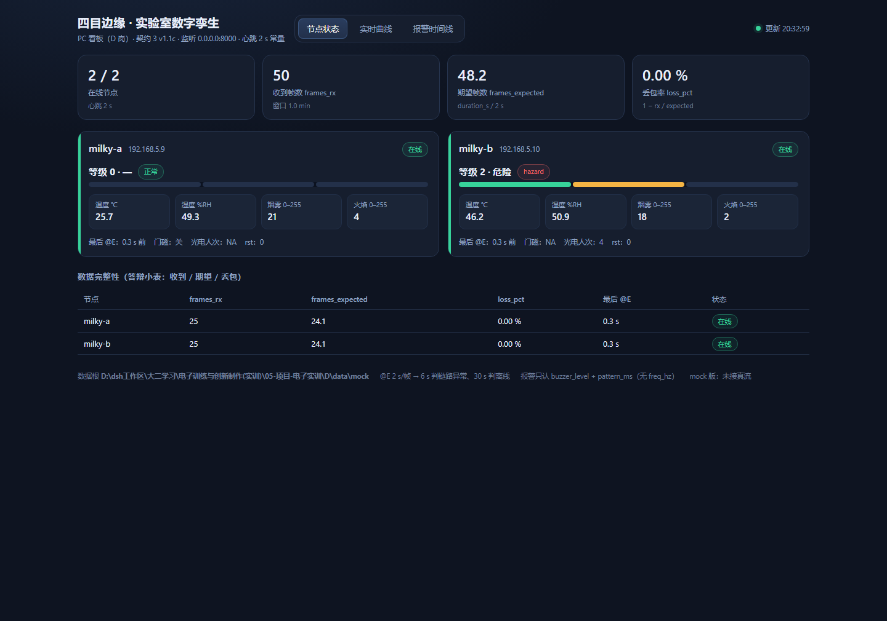
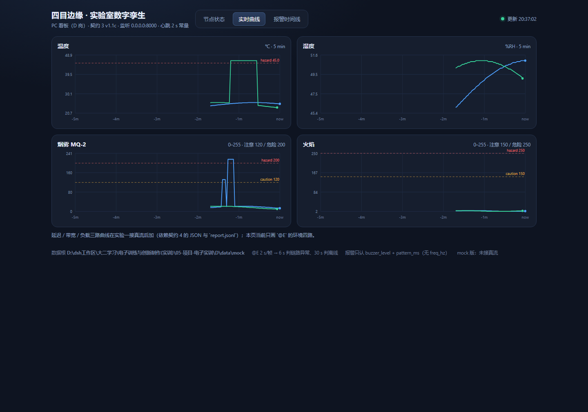
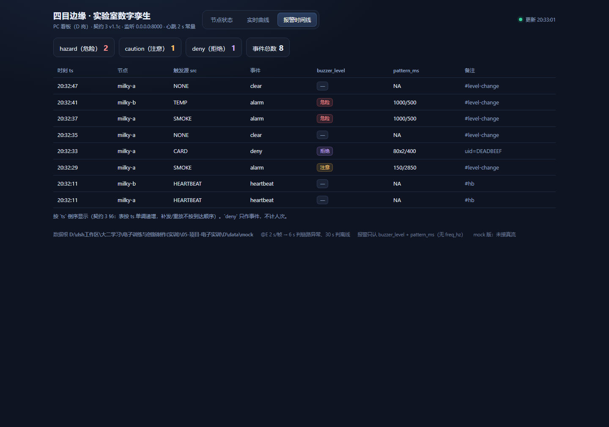
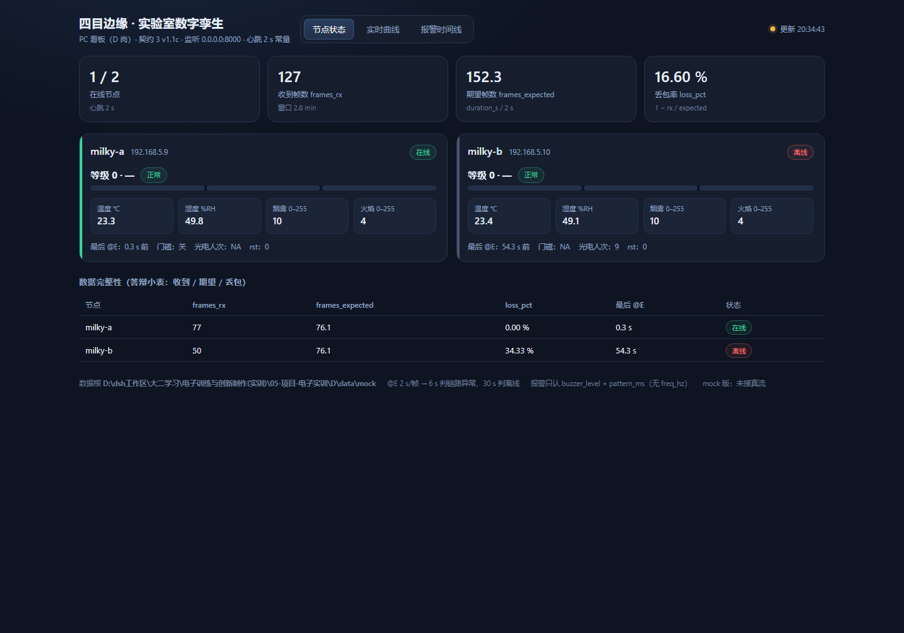

# PC 看板（`D/dashboard/`）· D3 mock 版

> D 岗交付物 3（`D/README` 表第 3 行）。当前是 **mock 版**：三个页面能跑、能收 `/ingest`、能落 CSV，**还没接真流**（等 B 的板子与契约 4）。
> 口径全部按 [`../契约3-实验数据CSV-schema-v1.1.md`](../契约3-实验数据CSV-schema-v1.1.md) **v1.1c**：心跳 2 s 常量、6 s 判链路异常、30 s 判离线、报警只认 `buzzer_level` + `pattern_ms`。

---

## 一、怎么跑（两个进程，无需装任何库）

```powershell
# 1) 看板（Python 3.8+ 标准库，无 Flask/pip）
cd D\dashboard
python app.py --data ../data --port 8000

# 2) mock 数据：每 2 s 一条 @E，2 个节点，第 100 s 起停发 milky-b（演离线）
python mock_feed.py --url http://127.0.0.1:8000/ingest --nodes milky-a,milky-b --duration 300 --drop-b-after 100

# 3) 异机自检（防火墙 + 监听是否真的通）
curl -X POST http://<PC_IP>:8000/ingest -d '{"type":"heartbeat","node":"milky-a"}'
```

浏览器开 `http://127.0.0.1:8000/`（本机）或 `http://<PC_IP>:8000/`（板子同网段）。

> **`--data` 就是契约 3 §1 的数据根**：正式跑用 `../data`（= `D/data/`）；mock 演示用 `../data/mock`，`raw/` 不会被假数据污染。换根不换 schema。

## 二、三个页面

| 页面 | 路由 | 看什么 |
|---|---|---|
| **节点状态** | `/` | 在线/链路异常/离线三态（按心跳 age 判定，不用 ping）、当前等级 0/1/2 + `buzzer_level`、温度/湿度/烟雾/火焰、门磁、`@C` 光电人次、`rst`；底部"数据完整性"= `frames_rx / frames_expected / loss_pct` |
| **实时曲线** | `/curves` | 温度 / 湿度 / 烟雾 / 火焰四路 rolling 5 min；烟雾画 120/200 阈值线，火焰画 150/250，温度画 45.0 |
| **报警时间线** | `/events` | 按 `ts` **倒序**显示（表本身按 ts 递增写入），每条带 `buzzer_level` 中文名 + `pattern_ms` 节奏；顶部 hazard / caution / deny 计数 |

### 截图（mock 跑 2.5 min 后截的，数据为假）

节点状态（milky-b 温度 46.2 ℃ → 等级 2 hazard；两节点 `frames_rx ≈ frames_expected`，loss 0）：



实时曲线（4 路，含阈值虚线）：



报警时间线（caution 1 / hazard 2 / deny 1，`80x2/400` 拒绝节奏）：



断线态：milky-b 停发 72 s 后 **灰显"离线"+ 最后 @E 时间**，不静默空白（"边缘自治"叙事的可视化证据）：



## 三、数据落在哪

| 内容 | 路径 | 说明 |
|---|---|---|
| 报警 / 心跳事件流 | `<data>/raw/events/<YYYYMMDD>.csv` | 列 = 契约 3 §6 六列（`ts,node_id,src,event,buzzer_level,pattern_ms,note`），按 ts 追加 |
| 每帧环境原始值 | `<data>/raw/env/<YYYYMMDD>.jsonl` | 一行一条 `@E`，含 `ts/node_id/t/h/smoke/flame/light/sound/rst` |
| mock 演示 | `<data>/mock/raw/...` | 只用于截图与联调，**不进报告** |

`raw/` 只读纪律不变：看板只追加，不改写；清洗产物以后由 `tools/clean.py` 写到 `data/clean/`。

## 四、`/ingest` 收什么（宽容解析）

现在按 B 的 `duo_bridge.py` 现状做了兼容，**契约 4 定稿后可能改字段**（到时升契约 3 v1.1d 并重签 B/D 两行）。

| `type` | 字段 | 落到 |
|---|---|---|
| `env`（`@E`） | `t,h,smoke,flame,light,sound,rst` | 节点环境、`frames_rx`+1、曲线、`raw/env/*.jsonl` |
| `A`（`@A`） | `args:[lv, src]`（`lv` 0/1/2，`src` NONE/SMOKE/FLAME/TEMP） | 等级变化才写事件：`lv>0` → `alarm`，`lv=0` → `clear`；`buzzer_level` 由 `lv` 映射 |
| `C`（`@C`） | `args:[n]` | 光电人次（实验二真值来源） |
| `D`（`@D`） | `args:[0|1]` | 门磁状态（**只显示，不参与判决**，契约 3 §6.1） |
| `card` / `R` | `uid`, `ok` | `ok=false` → 写一条 `src=CARD / event=deny / buzzer_level=deny / 80x2/400` |
| `heartbeat` | — | 只刷新 `last_seen`，不增加 `frames_rx` |

- **缺 `node` 字段**：落到 `--default-node`（默认 `milky-a`）。B 的 `duo_bridge.py` 三个 `post()` 现在都没带 `node`，多板会分不清——已在 [`../../共享/14-变更通知-1123/B-通知-视觉节点.md`](../../共享/14-变更通知-1123/B-通知-视觉节点.md) 提了，B 补上后这里自然按节点分开。
- **批次**：`{"batch":[ ... ]}` 或直接 POST 一个数组都收。

## 五、接口与自检

| 路由 | 用途 |
|---|---|
| `POST /ingest` | 收 B 的推送，返回 `{"ok":true}` |
| `GET /api/state` | 页面 2 s 轮询（节点、曲线、事件、完整性） |
| `GET /health` | 存活检查 |

```powershell
# 五个自检（D3 已跑通）
curl http://127.0.0.1:8000/health
curl -X POST http://127.0.0.1:8000/ingest -d '{"type":"env","node":"milky-a","t":25.3,"h":45.0,"smoke":12,"flame":3}'
curl http://127.0.0.1:8000/api/state
```

## 六、还没做的（别当成已交付）

1. **没接真流**：`frames_rx` 是 mock 造的，D6 前不能进报告。
2. **延迟 / 带宽 / 负载三路曲线未画**：要有 `report.jsonl`（B 侧 UDP 原始报文）与契约 4 的字段；`@E` 里没有这些量。
3. **`buzzer_level` 靠 `@A` 的 `lv` 映射**：固件不直接发 `buzzer_level`，映射表在 `app.py` 顶部 `LEVEL_NAME`，改阈值先改契约 3 §6.1。
4. **`clean.py` 未写**：本看板只负责收与落盘，14 条质量校验在 `tools/clean.py`（D6 交付）。
5. **防火墙**：Windows 入站 TCP 8000 必须放行；监听必须 `0.0.0.0`（写 `127.0.0.1` 时本机 curl 通、板子推不上来，这个坑排查很费时间）。
